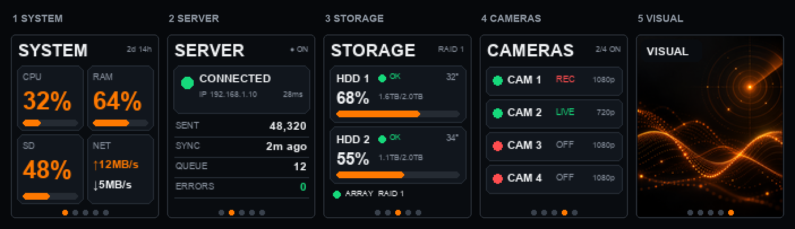

# OPiZ3 Dashboard

Пятистраничный интерфейс для TFT 128×160 в портретной ориентации на Orange Pi Zero 3.



1. **SYSTEM** — CPU, RAM, системная карта и скорость сети.
2. **SERVER** — доступность основного сервера, задержка, пакеты, очередь, ошибки и последняя синхронизация.
3. **STORAGE** — SMART двух внешних дисков, температура, заполнение и состояние RAID.
4. **CAMERAS** — четыре камеры, доступность и передача/запись.
5. **VISUAL** — PNG/JPEG/GIF; если файла нет, показывается встроенная анимация радара.

Короткое нажатие физической кнопки открывает следующую страницу. Длинное нажатие возвращает предыдущую. Сбор метрик выполняется в фоне, поэтому медленная камера или SMART не блокируют дисплей.

## Быстрый просмотр на компьютере

```bash
cd dashboard
python -m venv .venv
.venv/bin/pip install -r requirements.txt
cp config.example.json config.json
.venv/bin/python -m opiz_dashboard.main --config config.json --simulator
```

В Windows используйте `.venv\Scripts\python.exe`. В симуляторе: `Space`/`→` — следующая страница, `←` — предыдущая, `Esc` — выход. Для снимка конкретной страницы:

```bash
python -m opiz_dashboard.main --config config.json --page 3 --once preview-storage.png
```

## Установка на Orange Pi

```bash
sudo apt update
sudo apt install -y python3-venv smartmontools
sudo mkdir -p /opt/opiz-dashboard /etc/opiz-dashboard
sudo cp -r opiz_dashboard requirements.txt assets /opt/opiz-dashboard/
sudo python3 -m venv /opt/opiz-dashboard/.venv
sudo /opt/opiz-dashboard/.venv/bin/pip install -r /opt/opiz-dashboard/requirements.txt
sudo cp config.example.json /etc/opiz-dashboard/config.json
sudo cp opiz-dashboard.service /etc/systemd/system/
sudo systemctl daemon-reload
sudo systemctl enable --now opiz-dashboard
```

Перед запуском отредактируйте `/etc/opiz-dashboard/config.json`:

- `display.dc_line`, `reset_line`, `backlight_line` — **номера GPIO line**, а не номера контактов гребёнки;
- `button.line` и `button.enabled` — линия кнопки и её включение;
- `spi_bus`/`spi_device` — должны соответствовать `/dev/spidevX.Y`;
- `controller`, `x_offset`/`y_offset`, `bgr`, `invert`, `rotation` — параметры конкретной ревизии ST7735/ST7789;
- URL сервера, RTSP-адреса камер, диски и точки монтирования.

Поле `server.ip_address` можно оставить пустым — тогда адрес определяется из `server.url`. Значение `ip_address` из файла состояния имеет наивысший приоритет.

После настройки смените `display.backend` с `simulator` на `st77xx`. Неверные GPIO специально не подставлены автоматически: разводка Orange Pi и номера линий зависят от device tree и выбранных контактов.

## Формат файлов состояния

Приложение работает и без файлов состояния, проверяя сеть самостоятельно. Для точной статистики сервис загрузки камер может атомарно обновлять JSON:

```json
{
  "online": true,
  "ip_address": "192.168.1.10",
  "sent_packets": 48320,
  "last_sync": "2026-10-01T12:35:00+03:00",
  "queue": 12,
  "errors": 0
}
```

Файл камеры:

```json
{
  "online": true,
  "transferring": true,
  "resolution": "1080p",
  "fps": 25,
  "latency_ms": 18
}
```

`smartctl` обычно требует root или отдельного правила `sudoers`, поэтому unit по умолчанию запускается от root. После проверки доступа лучше ограничить права отдельным системным пользователем.
